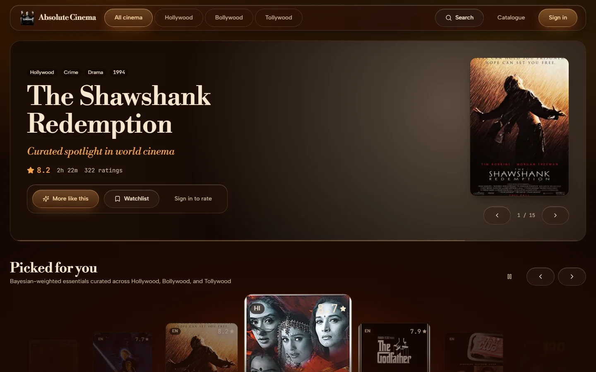
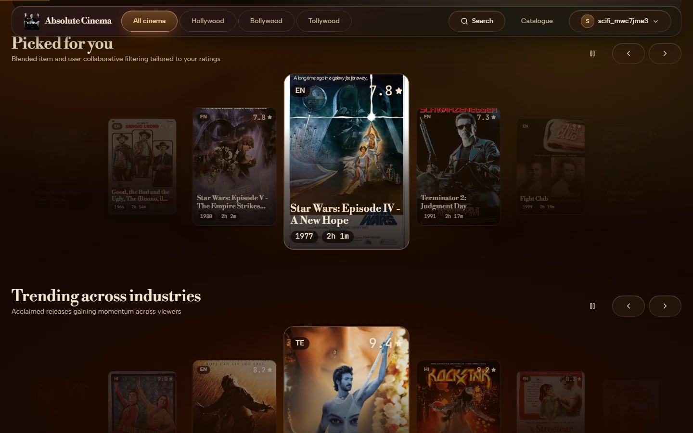
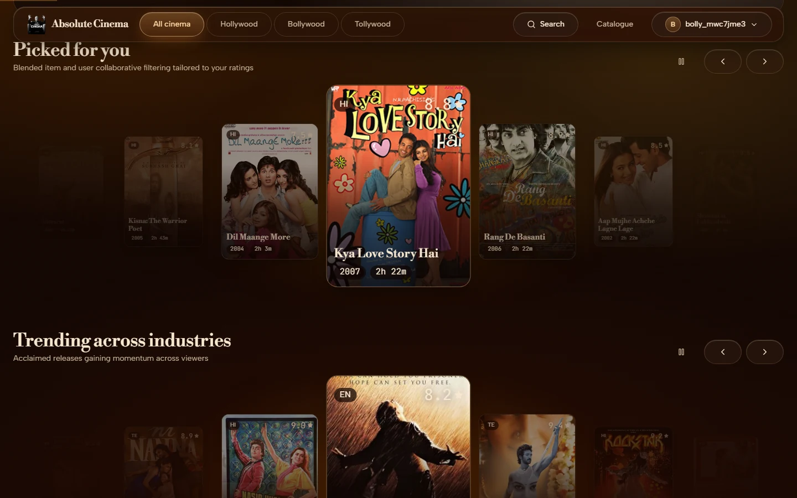
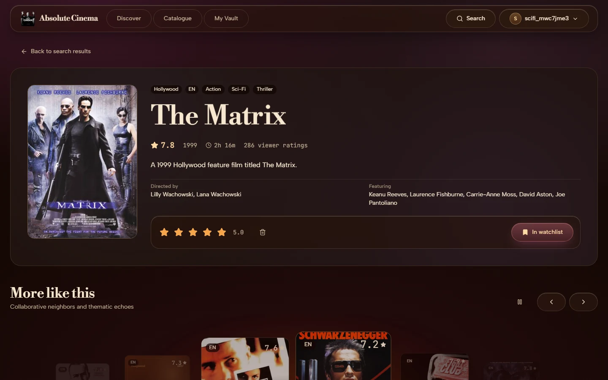
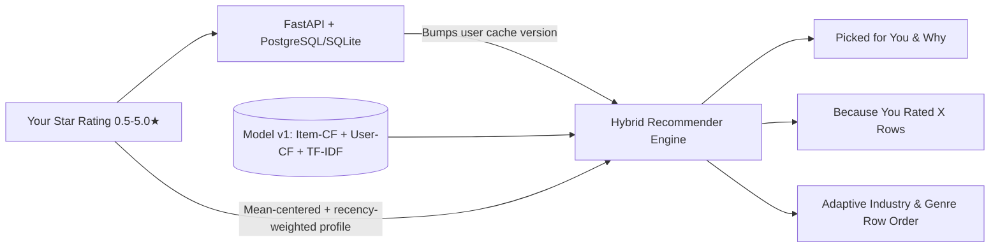

<p align="center">
  
</p>

<h1 align="center">ABSOLUTE CINEMA</h1>

<p align="center">
  <strong>A personal film curator across Hollywood, Bollywood, and Tollywood.</strong><br />
  Rate what moves you, watch every shelf adapt in real time, and understand why every film was chosen.
</p>

<p align="center">
  <a href="#act-iii--run-it-locally">Run Locally</a> •
  <a href="#act-iv--deploy-free-on-render">Deploy Free on Render</a> •
  <a href="#act-v--under-the-hood">Under the Hood</a> •
  <a href="docs/ARCHITECTURE.md">Architecture</a> •
  <a href="docs/API.md">API Reference</a>
</p>

> **Live Demo:** Deploy this Blueprint to Render in two minutes and replace this line with your Static Site URL (e.g. `https://absolute-cinema-web.onrender.com`). Note: on Render's free tier, the first request after 15 minutes of inactivity shows a *"Waking the projector…"* glass banner while the API container spins up (~30–60s).

---

## Act I — First Light: What It Feels Like

Absolute Cinema opens into a warm **Rich Espresso (`#1A0D06`)** and translucent amber glass theater that extracts a color atmosphere from each film's poster art, keeps smooth momentum scroll via `lenis`, and turns every star rating you save into live-recomputed recommendations.



### One App, Distinct Taste Worlds

Every signed-in viewer gets an isolated taste profile, server-verified ratings vault, adaptive shelf ordering, and *"Because you rated…"* shelves:

| Sci-Fi Viewer (`scifi_*` — rates *The Matrix*, *Inception*, *Interstellar* 5★) | Bollywood Romance Viewer (`bolly_*` — rates *Dilwale*, *Devdas*, *Fanaa* 5★) |
|---|---|
|  |  |

### Film Detail Explanations & Mobile Viewport (`375px`)

| Poster Reveal, Explainability & Rating Dock | Responsive Mobile Spotlight (`375px`) |
|---|---|
|  |  |

---

## Act II — How Recommendations & Privacy Work

Instead of static popularity lists, Absolute Cinema blends four signals the instant you rate, re-rate, or clear a film—with **zero cron wait or model retraining required**:



- **Instant personalization & cold start**: New viewers with 0–4 ratings blend Bayesian acclaim with their onboarding genre/industry choices; starting from 5+ ratings, collaborative item-item and dynamic user-user similarities take over cleanly. Harsh raters (mean ~2.5★) and generous raters (mean ~4.8★) are centered around their own baselines, recent ratings carry higher weight, and low ratings (`1–2★`) actively push similar titles down.
- **Zero-rating movies stay discoverable**: Films without collaborative history fall back to TF-IDF synopsis, genre, industry, and language similarity.
- **Transparency**: Cards and detail pages surface *"Because you rated X, Y"* anchors explaining which films pulled a title into your shortlist.
- **Honest data disclosure**: Out of **83,473** baseline interactions across **2,300** catalogue films (`1,350` Hollywood, `475` Bollywood, `475` Tollywood), **67,881** are real MovieLens `ml-latest-small` ratings, and **15,592** are deterministically seeded (`random_state=42`) synthetic ratings flagged `source='synthetic'` to bridge Bollywood/Tollywood coverage. All evaluation metrics below report MovieLens-only and full-catalogue slices separately.
- **Private accounts by default**: Passwords use `bcrypt`, historical CF profiles have `password_hash=None` and cannot be signed into, JWT + rotating `HttpOnly` refresh cookies derive `user_id` strictly on the server, and logging out or switching accounts immediately clears React Query caches and session storage (`clearUserBrowserState`).

---

## Act III — Run It Locally

### Option A — 5-Step Docker Setup (Recommended)

1. **Clone the repository**
   ```bash
   git clone <your-repo-url>
   cd absolute-cinema
   ```
2. **Create your environment config**
   ```bash
   cp .env.example .env
   ```
3. **Start PostgreSQL, FastAPI, and Nginx + React**
   ```bash
   docker compose up --build
   ```
4. **Open the app** at `http://localhost:8080` (API healthcheck at `http://localhost:8000/api/health`).
5. **Run the verification smoke test** against the running API:
   ```bash
   python scripts/smoke_test.py --base-url http://localhost:8000
   ```

### Option B — Local Python + Vite (No Docker Required)

```bash
# 1. Environment & secrets (for zero-Postgres local trial, set DATABASE_URL=sqlite:///./cinema_dev.db)
cp .env.example .env

# 2. Backend dependencies (Python 3.10+ / 3.11+)
pip install -r backend/requirements.txt

# 3. Migrate schema & load catalogue + trained v1 artifact
cd backend
alembic upgrade head
PYTHONPATH=.:.. python -m app.services.seed

# 4. Start FastAPI (port 8000) & Vite frontend (port 5173)
PYTHONPATH=.:.. uvicorn app.main:app --host 127.0.0.1 --port 8000
cd ../frontend && npm ci && npm run dev -- --port 5173
```

Open `http://localhost:5173` — Vite automatically proxies `/api/*` requests to `http://127.0.0.1:8000`.

### Optional: Enabling Google Sign-In

1. Create a Web OAuth 2.0 Client ID in **Google Cloud Console → Credentials**.
2. Under **Authorized JavaScript origins**, add `http://localhost:5173`, `http://localhost:8080`, and your production Render Static Site URL.
3. Set both `GOOGLE_CLIENT_ID` (backend) and `VITE_GOOGLE_CLIENT_ID` (frontend build env). Leaving them empty cleanly hides the Google button while keeping email/password accounts working.

---

## Act IV — Deploy Free on Render

This repository ships with [`render.yaml`](render.yaml) — an infrastructure-as-code Blueprint provisioning:
1. **`absolute-cinema-db`** (`plan: free` PostgreSQL)
2. **`absolute-cinema-api`** (`plan: free` Docker API running `$PORT` via `backend/Dockerfile`)
3. **`absolute-cinema-web`** (Render Static Site with SPA `/* -> /index.html` rewrite, `Strict-Transport-Security`, CSP, and long-lived asset caching)

### Blueprint Steps

1. Push this repository to GitHub (see commands printed in your handoff).
2. In the Render Dashboard, choose **New → Blueprint** and connect your GitHub repository.
3. Fill the prompted `sync: false` variables:
   - On **`absolute-cinema-api`**:
     - `ALLOWED_ORIGINS`: exact URL of your static site (`https://your-site.onrender.com`)
     - `FRONTEND_URL`: same frontend URL (`https://your-site.onrender.com`)
     - `ADMIN_PASSWORD`: strong passphrase (or leave empty to skip seeding an admin login)
     - `GOOGLE_CLIENT_ID`: optional Web OAuth Client ID
   - On **`absolute-cinema-web`**:
     - `VITE_API_BASE_URL`: full API URL + `/api` (e.g. `https://absolute-cinema-api.onrender.com/api`)
     - `VITE_GOOGLE_CLIENT_ID`: same optional OAuth Client ID
4. Click **Apply**. Backend startup automatically normalizes Render's `postgres://` URI into `postgresql+psycopg://` and keeps `SameSite=None; Secure` cookies active for cross-origin sessions.
5. Verify your live stack with:
   ```bash
   python scripts/smoke_test.py --base-url https://absolute-cinema-api.onrender.com --frontend-url https://your-site.onrender.com
   ```

> **Free-Tier Notes:** Free web services spin down after 15 minutes idle (~30–60s cold wake handled gracefully in UI with backoff retries), and Render Free PostgreSQL databases expire 90 days after creation unless upgraded or exported.

---

## Act V — Under the Hood

### Architecture & Repository Map

```text
├── backend/              FastAPI API, SQLAlchemy models, Alembic migrations, Dockerfile
├── frontend/             React 19 + TypeScript + Tailwind + Vite SPA (Lenis + GSAP)
├── ml/                   CF + TF-IDF training pipeline, offline evaluator, v1 artifacts
├── scripts/              Production smoke verification CLI (`smoke_test.py`)
├── docs/                 ARCHITECTURE.md, API.md, postman_collection.json, screenshots/
├── docker-compose.yml    Local 3-service stack (Postgres 16 + API + Nginx SPA)
└── render.yaml           One-click Render Free Tier Blueprint
```

### Offline Model Metrics (`model_v1.joblib`)

Trained on 67,135 train/validation ratings across 2,300 films with deterministic chronological user holdout evaluation (`test_ratings = 16,338`):

| Slice | Evaluator Users | Hybrid RMSE | Hybrid MAE | Precision@10 | Recall@10 | Coverage@10 |
|---|---|---|---|---|---|---|
| **MovieLens Real Only** (`13,332` test) | `587` | **`0.8446`** | **`0.6405`** | **`0.0693`** | **`0.0593`** | `0.1483` |
| **All Catalogue** (`16,338` test) | `902` | **`0.8271`** | **`0.6318`** | **`0.0473`** | **`0.0418`** | `0.1704` |

*(Versus baselines on MovieLens: Item-CF RMSE `0.8605`, User-CF RMSE `0.8869`. Weights tuned on validation holdout: `alpha=0.65`, `cf_weight=0.70`, `content_weight=0.30`, `taste_weight=0.32`.)*

---

## Act VI — Troubleshooting & FAQ

- **Why did the first request after idle take ~40 seconds on Render?** Free-tier containers sleep after 15 minutes of inactivity. The frontend automatically retries idempotent `GET` requests with backoff while displaying *"Waking the projector…"*.
- **Why do Safari / Incognito browsers sometimes ask me to sign in again after reload?** Render deploys the Static Site and API on separate subdomains (`*.onrender.com`), so browsers blocking third-party cookies drop cross-site `HttpOnly` refresh cookies; in-memory access tokens remain valid for 15 minutes (`ACCESS_TOKEN_EXPIRE_MINUTES`). Hosting frontend + API under custom subdomains of one domain restores seamless silent refresh everywhere.
- **How quickly do ratings affect *"Picked for you"*?** Immediately on the next fetch (`PUT /api/ratings/{movie_id}` invalidates `(user_id, ratings_version)` on the server and invalidates React Query `["recs"]` / `["because"]` on the client).
- **Can I switch accounts without mixing recommendations?** Yes. Both backend token rotation (`_revoke_cookie_refresh_token`) and frontend `clearUserBrowserState` wipe stale caches, watchlist state, and carousel positions synchronously on sign-in/sign-out.
- **Do I need a `TMDB_API_KEY` to run the app?** No. Seeded metadata and poster URLs live cleanly inside [`ml/data/processed/`](ml/data/processed/); `TMDB_API_KEY` is used only when running the optional offline enrichment script.
- **What happens to a Render Free PostgreSQL instance after 90 days?** Render expires free Postgres databases after 90 days. Export your user/ratings tables or upgrade the database plan in `render.yaml` before day 90.
- **Can I run locally without Postgres?** Yes for quick dev checks (`DATABASE_URL=sqlite:///./cinema_dev.db`), while production and CI target PostgreSQL 16 via `psycopg`.
- **Where are API specs and sample requests?** See [`docs/API.md`](docs/API.md) and [`docs/postman_collection.json`](docs/postman_collection.json).

---

## Credits & License

- **Film Data & Posters**: Metadata, poster URLs, and schema attribution follow MovieLens (`ml-latest-small`, GroupLens Research) and TMDB conventions. *This product uses the TMDB API architecture and dataset conventions but is not endorsed or certified by TMDB.*
- **Core Stack**: [FastAPI](https://fastapi.tiangolo.com/), [SQLAlchemy](https://www.sqlalchemy.org/), [scikit-learn](https://scikit-learn.org/), [React](https://react.dev/), [TanStack Query](https://tanstack.com/query), [Lenis](https://lenis.darkroom.engineering/), and [GSAP](https://gsap.com/).
- **License**: Released under the [MIT License](LICENSE).
